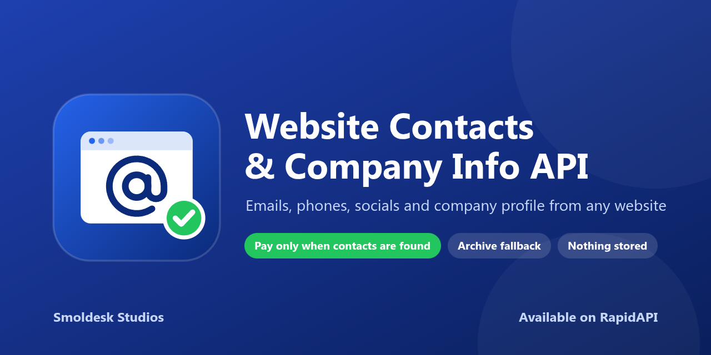

# Website Contacts & Company Info API



Turn any business website into a contact record in one call: **emails, phone numbers, social profiles, contact-form URL and company profile** (name, description, logo, language).

**[Get a free API key on RapidAPI →](https://rapidapi.com/smoldesk-studios-team-alpha-001/api/website-contacts-company-info)**

- **You only pay when we find contacts.** Lookups that find nothing, or hit a blocked or unreachable site, don't use your Lookups quota.
- **Honest hit rate.** On 100 real local-business websites we found contacts on 82 (93% of the sites that had any).
- **Fast.** About 1.5 s median per website. We check the homepage plus up to 3 contact/about pages, in parallel.
- **Works when sites block bots.** If the live site refuses us, we use its latest Wayback Machine snapshot and tell you so.
- **Nothing stored.** Every call is a live lookup. We keep no database of results.

This repo has the API docs, the OpenAPI spec and ready-to-run examples. The API itself is hosted; you call it through RapidAPI.

## Quick start

```bash
curl --request GET \
  --url 'https://website-contacts-company-info.p.rapidapi.com/v1/contacts?domain=cafemaltaaustin.com&country=US' \
  --header 'x-rapidapi-host: website-contacts-company-info.p.rapidapi.com' \
  --header 'x-rapidapi-key: YOUR_RAPIDAPI_KEY'
```

Response (shortened):

```json
{
  "input": "cafemaltaaustin.com",
  "url": "https://www.cafemaltaaustin.com/",
  "status": "contacts_found",
  "source": "live",
  "company": { "name": "Cafe Malta", "logo": "https://images.squarespace-cdn.com/…/favicon.ico", "language": "en-US" },
  "emails": [
    { "email": "info@cafemaltaaustin.com", "type": "generic", "ownDomain": true,
      "foundOn": "https://www.cafemaltaaustin.com/", "foundIn": "mailto link", "domainAcceptsMail": true }
  ],
  "phones": [
    { "international": "+1 512 853 9584", "e164": "+15128539584", "country": "US", "foundOn": "https://www.cafemaltaaustin.com/" }
  ],
  "socials": {
    "facebook": ["https://www.facebook.com/cafemalta"],
    "instagram": ["https://www.instagram.com/cafemalta"]
  },
  "contactFormUrl": null,
  "pagesChecked": ["https://www.cafemaltaaustin.com/"],
  "tookMs": 678
}
```

## Examples

| File | What it does |
|---|---|
| [`examples/curl.sh`](examples/curl.sh) | One lookup from the shell. |
| [`examples/python/lookup.py`](examples/python/lookup.py) | One lookup in Python, printing emails, phones and socials. |
| [`examples/python/bulk_csv.py`](examples/python/bulk_csv.py) | Enrich a CSV (try [`leads.example.csv`](examples/python/leads.example.csv)) of websites (e.g. a Google Maps export) into a CSV with emails, phones and socials. Parallel, with retry on rate limits. |
| [`examples/node/lookup.mjs`](examples/node/lookup.mjs) | One lookup in Node.js 18+ (built-in `fetch`). |

Set your key first: `export RAPIDAPI_KEY=your_key_here`.

## Parameters

| Name | Required | Description |
|---|---|---|
| `domain` | yes | Domain or URL of the website. `example.com`, `https://www.example.com/contact`, `HTTP://EXAMPLE.COM` and IDNs all work. |
| `country` | no | 2-letter country code (`US`, `GB`, `MY`…) used to read local phone numbers written without a country code. Guessed from the domain's country TLD if omitted. **Set it for .com sites.** |
| `emails` | no | `all` (default) or `generic` (role addresses only, such as info@, sales@, booking@). |

## Status values

Every lookup returns **HTTP 200** with a `status`. Only a bad parameter returns 400.

| `status` | Meaning | Uses a Lookup |
|---|---|---|
| `contacts_found` | At least one email, phone or social profile was found. | yes |
| `no_contacts_found` | The site loaded but showed no contact details. | no |
| `blocked` | The site refused us or showed a bot check, and no archive copy exists. | no |
| `unreachable` | DNS error, timeout or server error, and no archive copy exists. | no |
| `not_html` | The URL is a file (PDF, image…), not a web page. | no |
| `skipped_social_profile` | The input is, or redirects to, a social network page. | no |
| `invalid_input` | A parameter is not valid (HTTP 400). | no |

## Response fields

- **`emails[]`**: `email`, `type` (`generic` or `personal`), `ownDomain`, `foundOn`, `foundIn` (`schema.org`, `mailto link`, `page text`, `page source`), `domainAcceptsMail` (the domain has mail records; `null` if not checked). Emails on the site's own domain come first.
- **`phones[]`**: `international`, `e164`, `country`, `foundOn`. Every number is validated.
- **`socials`**: profile URLs per network. Possible keys: `facebook`, `instagram`, `linkedin`, `twitter`, `tiktok`, `youtube`, `pinterest`, `whatsapp`, `telegram`, `snapchat`, `github`.
- **`contactFormUrl`**, **`company`** (`name`, `description`, `logo`, `language`), **`url`**, **`domain`**, **`redirectedTo`**, **`source`** (`live` or `archive`), **`archivedAt`**, **`pagesChecked`**, **`tookMs`**.

Full schema: [`openapi.yaml`](openapi.yaml).

## Tips

- Set your HTTP timeout to **60 seconds**. Most lookups take 1 to 3 s, but slow or blocked sites can take up to about 40 s.
- For bulk lists, run requests in parallel up to your plan's rate limit and retry `429` responses after a short wait (see `bulk_csv.py`).
- Keep the `foundOn` URL if you need to show where each email or phone came from.

## Plans

A free BASIC plan (50 Lookups/month) is enough to try it. Paid plans start at $15/month. See [pricing on RapidAPI](https://rapidapi.com/smoldesk-studios-team-alpha-001/api/website-contacts-company-info/pricing).

## Use lawfully

The API reads only public web pages at the moment you ask, and stores nothing. You are responsible for how you use the results, including GDPR, CAN-SPAM, PDPA and anti-spam rules. Use `emails=generic` if you only want role addresses.

## Support

Open an [issue](../../issues) or use the Discussions tab on the RapidAPI listing. Include the domain you tested.

---

Made by **Smoldesk Studios**. The examples in this repo are MIT licensed.
